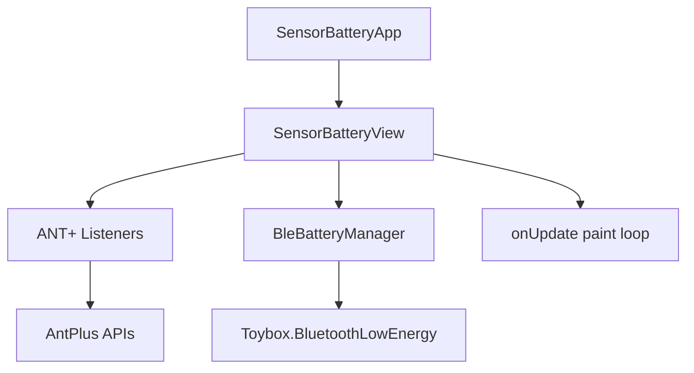

# Architecture

## Overview

Sensor Battery is a Connect IQ **data field** (`type="datafield"` in `manifest.xml`). It displays battery status for cycling sensors connected via ANT+ and BLE on a single scrolling list.

## Source files

| File | Lines | Role |
|------|-------|------|
| `SensorBatteryApp.mc` | ~35 | App entry, creates View, reloads settings |
| `SensorBatteryView.mc` | ~1976 | Data field UI, ANT+ listeners, row rendering |
| `SensorBatteryBackground.mc` | ~28 | White background drawable |
| `BleBatteryManager.mc` | ~2060 | BLE scan/pair/read state machine |

## SensorBatteryView

Extends `WatchUi.DataField`. Owns all ANT+ sensor subscriptions and the display logic.

### ANT+ listeners (inner classes)

| Listener | AntPlus type | Battery source |
|----------|--------------|----------------|
| `MyShiftingListener` | Shifting | Per-component Di2 battery |
| `MyBikeRadarListener` | BikeRadar | Rear Varia light (same device) |
| `MyLightNetworkListener` | LightNetwork | Front light |
| `MyBikePowerListener` | BikePower | L/R power meter |
| `MyBikeCadenceListener` | BikeCadence | Cadence sensor |
| `MyBikeSpeedListener` | BikeSpeed | Speed sensor |

Lifecycle is managed in `syncSensorLifecycle()` — listeners are created/destroyed based on user settings and activity state.

### Display pipeline

1. `compute()` — run ANT+ battery polling, BLE identity feed and sampling, then light/device battery polling in separate stages
2. `onUpdate()` / `onUpdateInner()` — build row buffers (`mRowSortKeys`, `mRowTexts`, `mRowColors`), sort by position, draw with adaptive font ladder

Row buffers are reused each frame to avoid allocations on constrained devices.

The compute stages return before the next stage runs. This releases ANT+ polling
locals before the nested registry-to-BLE identity feed, avoiding stack exhaustion
on the Edge 530.

### Identity feed (ANT → BLE)

`feedAntIdsToBleMgr()` and related helpers push registered sensor IDs, names, and optional BLE addresses from Garmin's sensor registry into `BleBatteryManager`. This lets BLE scans match the correct HRM, power meter, or Di2 unit when multiple devices are nearby.

Key methods:
- `maybeFeedAntIdsToBleMgr()` — throttled full feed (every 15 ticks)
- `pushLiveHrmAntTarget()` — updates live HRM ANT ID when HR data is active
- `pushLiveAntIdsCheap()` — lightweight live ID updates for PM and Di2

## BleBatteryManager

Manages BLE battery reads for three device types in a round-robin:

| Slot | Device | Refresh interval |
|------|--------|------------------|
| `DEV_HRM` (1) | Heart rate monitor | 1200 ticks |
| `DEV_PM` (2) | Power meter | 7200 ticks |
| `DEV_DI2` (0) | Shimano Di2 | 7200 ticks |

### Phase state machine

When several slots need sampling, phases run in priority order: HRM → HRM_WAIT → PM → PM_WAIT → Di2 → DI2_WAIT → IDLE.

Each phase: scan → pair (deferred to `compute()`, not scan callback — CIQQA-4261) → discover Battery Service → read characteristic → disconnect → next phase. Battery values remain cached for display, but no BLE device intentionally remains connected while the manager is idle.

### Manager states

`MGR_OFF` → `MGR_SCANNING` → `MGR_RUNNING` → back to scanning, with `MGR_ERROR` / `MGR_IDLE` for backoff.

Per-device states: `DS_IDLE` → `DS_PAIRING` → `DS_SUBSCRIBING` → `DS_ACTIVE` → `DS_DISCONNECTED`.

### Matching

BLE scan results are matched against ANT candidate IDs and Garmin-stored sensor names using:
- `MATCH_ID` — ANT ID match
- `MATCH_STRICT` — ID + name match
- Optional BLE address from `SensorInfo`

HRM and PM use the original service-based discovery cadence: 45-tick sample
phases, 10-tick scan windows, and scan pauses starting at 20 ticks and capped at
120. Each callback filters advertisements by category, compares every compatible
BLE name against that category's ANT candidate IDs, and selects the active-ID
match first, another registered-ID match second, or otherwise the strongest
compatible signal. Garmin display names do not affect HRM/PM identity matching.
Discovery does not require activity heart-rate data or a connected ANT power
listener. Refresh intervals remain 1200 ticks for HRM and 7200 for PM/Di2,
including readings obtained through signal fallback.

A callback hands its fresh winner to the next `compute()` tick. It does not wait
through identity-ranking windows or retain native results across scan restarts.
`pairDevice()` stays in `compute()` rather than a scan callback. Null returns and
pairing exceptions discard the failed result and return the slot to discovery;
connection failures release the pairing slot. A successful connection clears a
previous transient pairing error. Debug rows show Garmin sensor names under `A:`
and the pairing target under `P:`.

Battery percentage and source name are cached together only after a successful
read. An ID match resolves to its Garmin display name; a signal fallback uses the
BLE-advertised name. Failed attempts do not rename a cached reading. Di2's
Shimano filtering, serial verification, persisted serial and naming remain unchanged.

## Settings integration

`loadSettings()` reads Connect IQ properties and toggles sensor visibility, row positions, text zoom, debug mode, and BLE rescan flag. Changes trigger `syncSensorLifecycle()` to start/stop listeners.

## Permissions

From `manifest.xml`: Ant, BluetoothLowEnergy, Sensor, SensorHistory, UserProfile.
